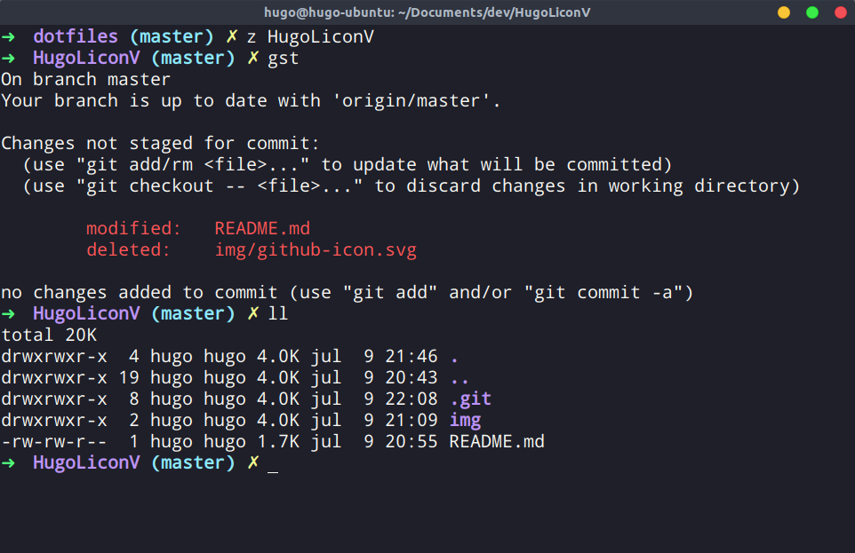
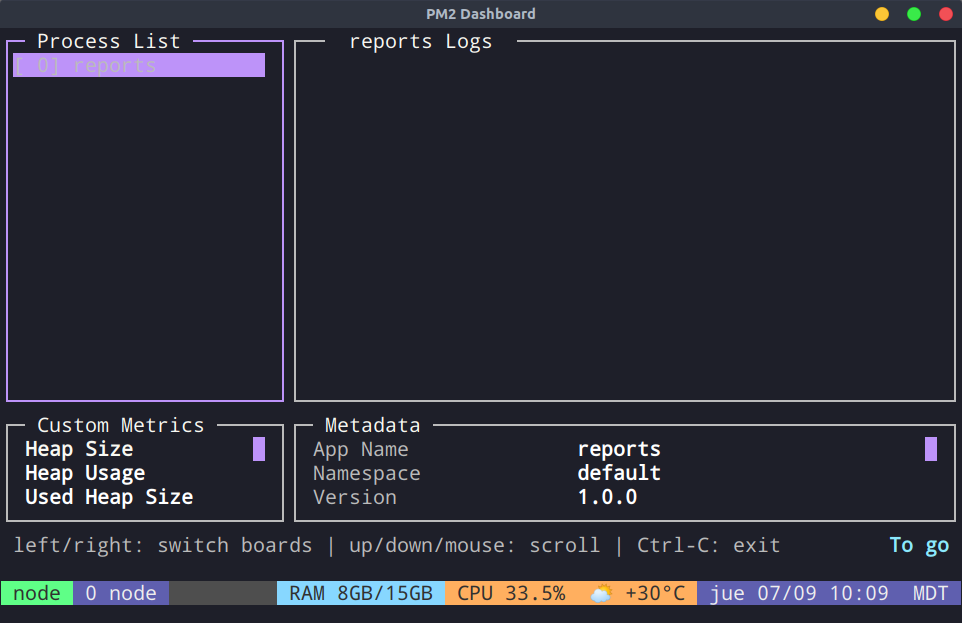
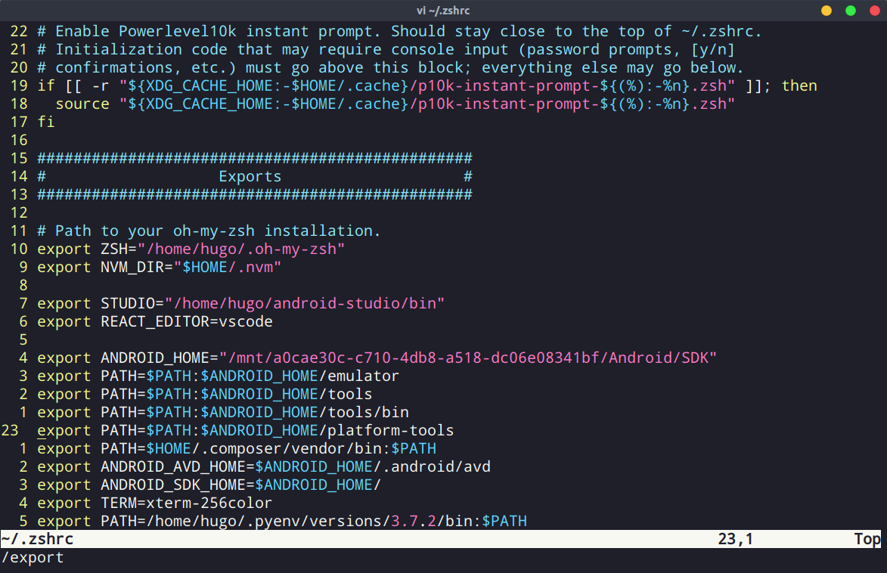

# dotfiles
Compilation of all of my dotfiles

## Installation
Clone repository.

```bash
git clone https://github.com/HugoLiconV/dotfiles.git ~/dev/dotfiles
export DOTFILES=~/dev/dotfiles   # wherever you cloned it
```

### Setup Vim
```bash
ln -s $DOTFILES/.vimrc ~/.vimrc
```

### Install tmux
```bash
brew install tmux
```

Create Symlink
```bash
ln -s $DOTFILES/.tmux.conf ~/.tmux.conf
```

### Install Tmux Plugin Manager (tpm)
```bash
git clone https://github.com/tmux-plugins/tpm ~/.tmux/plugins/tpm
```
Install plugins
1. Press `prefix` + `I` (Capital i, as in Install). The prefix is `Ctrl + a`

### Setup herdr
Install [herdr](https://herdr.dev), then create symlinks for the config and the status bar scripts
```bash
mkdir -p ~/.config/herdr
ln -s $DOTFILES/.config/herdr/config.toml ~/.config/herdr/config.toml
ln -s $DOTFILES/.config/herdr/status ~/.config/herdr/status
```
Apply changes with `herdr server reload-config`. The prefix is `Ctrl + a`

### Install Oh My Zsh
```bash
sh -c "$(curl -fsSL https://raw.githubusercontent.com/ohmyzsh/ohmyzsh/master/tools/install.sh)"
```

Create Symlink
```bash
# Remove default .zshrc file
rm ~/.zshrc
# Create a symlink
ln -s $DOTFILES/.zshrc ~/.zshrc
```

Install Dracula Theme
```bash
git clone https://github.com/dracula/zsh.git
# Create a symbolic link to oh-my-zsh's theme folder:
ln -s ~/zsh/dracula.zsh-theme ~/.oh-my-zsh/themes/dracula.zsh-theme
```

Install zsh-autosuggestions
```bash
git clone https://github.com/zsh-users/zsh-autosuggestions ${ZSH_CUSTOM:-~/.oh-my-zsh/custom}/plugins/zsh-autosuggestions
```

### Install CLI tools
```bash
# macOS
brew install jq fzf ripgrep bat eza zoxide

# Ubuntu (eza is in apt from 24.04; bat installs as `batcat`)
sudo apt install jq fzf ripgrep bat eza zoxide
```

`.zshrc` sets up fzf and zoxide automatically and adds aliases for bat and eza. Every alias is only defined when its tool is installed.

## CLI tools

### jq
Reads, filters and pretty-prints JSON.
```bash
jq . data.json                     # pretty-print a file
curl -s https://api.github.com/repos/HugoLiconV/dotfiles | jq '.stargazers_count'
jq -r '.dependencies | keys[]' package.json   # -r prints raw strings, without quotes
```

### fzf
Fuzzy finder: type a few letters to filter any list, then pick one with the arrow keys and Enter.
- `Ctrl + R`: search your command history
- `Ctrl + T`: pick a file and insert its path into the command
- `Alt + C`: pick a folder and `cd` into it (on macOS, set your terminal to treat Option as Alt)
```bash
vim $(fzf)        # open whichever file you pick
cd **<Tab>        # fuzzy-complete a path for any command
```

### ripgrep (`rg`)
A much faster `grep` for searching code. It skips files listed in `.gitignore` by default.
```bash
rg "TODO"            # search the current folder, recursively
rg -i "useState"     # ignore case
rg -t js "fetch"     # only JavaScript files
rg -l "API_KEY"      # only list the files that match
```

### bat (alias `b`)
`cat` with syntax highlighting, line numbers and git changes in the margin.
```bash
b .zshrc             # view a file
b -r 10:20 .zshrc    # only lines 10 to 20
b -p .zshrc          # plain output, for copying
```

### eza (aliases `ll`, `lt`)
A modern `ls` with colors and git status.
```bash
ll                           # eza -lah --git: list everything, with git status per file
lt                           # eza --tree --level=2: folder tree, two levels deep
eza --tree --level=3 src     # deeper tree of a specific folder
```

### zoxide (`z`, `zi`)
A smarter `cd` that learns which folders you visit and jumps to them from part of a name.
```bash
z dotfiles      # jump to the most used folder matching "dotfiles"
z dev dot       # several words narrow it down (~/dev/dotfiles)
zi              # pick from your visited folders with fzf
z -             # go back to the previous folder
zoxide import --from=z ~/.z   # one-time: import history from the old z.sh
```

## Screenshots

###  Terminator


### Tmux


### Vim

